<div align="center">

<picture>
  <source media="(prefers-color-scheme: dark)" srcset="docs/readme/logo-dark.svg"/>
  
</picture>

**Every account. One portfolio.**

A read-only portfolio tracker for Canadian investors. Questrade, Wealthsimple and Interactive Brokers<br/>in one reconciled ledger, priced live in one base currency.

   

[Run the demo](#run-the-demo) · [How it works](#how-it-works) · [Screens](#screens) · [Configuration](#run-against-your-accounts)

<br/>

<picture>
  <source media="(prefers-color-scheme: dark)" srcset="docs/readme/hero-dark.svg"/>
  
</picture>

</div>

## What it does

- **One portfolio across institutions.** Holdings, cash and options from every linked account, summed per symbol, with book cost, unrealized P/L and weight.
- **A ledger you can audit.** Every broker transaction is stored, classified and exportable to CSV with exact decimals.
- **Live P/L.** Positions are re-priced on the server and pushed to the dashboard every 5 seconds.
- **One base currency.** USD, GBP and CAD positions roll up at spot FX into CAD, while each position keeps its listing currency.
- **Read-only.** InvestIQ never calls an order or transfer endpoint on any broker.

## How it works

### Read-only by design

Questrade connects directly over OAuth. Its refresh token rotates and is persisted on every refresh. Wealthsimple and Interactive Brokers are linked through SnapTrade with a read-only connection. A sync makes all of its broker calls first and only then writes and commits, so a failed sync never leaves partial data. Later syncs resume from a per-account cursor with a 7-day overlap.

<picture>
  <source media="(prefers-color-scheme: dark)" srcset="docs/readme/sync-dark.svg"/>
  
</picture>

Accounts the broker stops returning are marked removed. A SnapTrade account that mirrors a direct Questrade account is flagged as a duplicate, so it is never counted twice. Credentials are encrypted at rest with Fernet.

### A ledger that has to balance

Every stored row is classified when it is read: equity or option trade (told apart by contract multiplier), dividend, interest, corporate action, option expiry, FX conversion. Holdings use average cost (ACB). For each account, the balance minus net deposits must equal unrealized + realized + income. Any gap is reported, along with checks for negative cash, oversold lots and share counts that disagree with the broker.

<picture>
  <source media="(prefers-color-scheme: dark)" srcset="docs/readme/ledger-dark.svg"/>
  
</picture>

The broker's position snapshot decides what is held. Transaction-derived cost is used only when it reproduces the broker's quantity; otherwise the broker's average cost is used, and the position says so.

### Live P/L over Server-Sent Events

`GET /api/stream/pnl` sends the first frame at once, then one every 5 seconds. Each frame is a base64 `PnLUpdate` protobuf: positions, per-currency totals, FX rates and per-account summaries. Quote provider errors become SSE comments, and the stream keeps going.

<picture>
  <source media="(prefers-color-scheme: dark)" srcset="docs/readme/stream-dark.svg"/>
  
</picture>

### One base currency

Totals convert at spot FX into `BASE_CURRENCY` (CAD by default). London pence quotes are normalized to pounds. If a rate is missing, the total is marked incomplete. It is never guessed.

<picture>
  <source media="(prefers-color-scheme: dark)" srcset="docs/readme/fx-dark.svg"/>
  
</picture>

## Screens

<table>
  <tr>
    <td width="50%"><picture><source media="(prefers-color-scheme: dark)" srcset="docs/readme/holdings-dark.webp"/>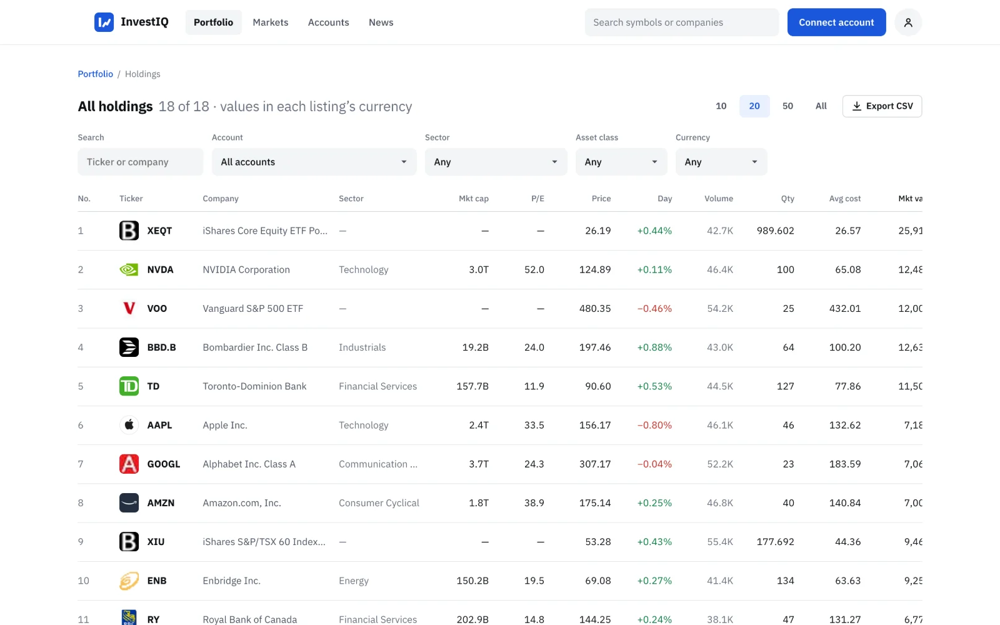</picture><br/><sub><b>Holdings.</b> One row per symbol across accounts, with filters and CSV export.</sub></td>
    <td width="50%"><picture><source media="(prefers-color-scheme: dark)" srcset="docs/readme/markets-dark.webp"/>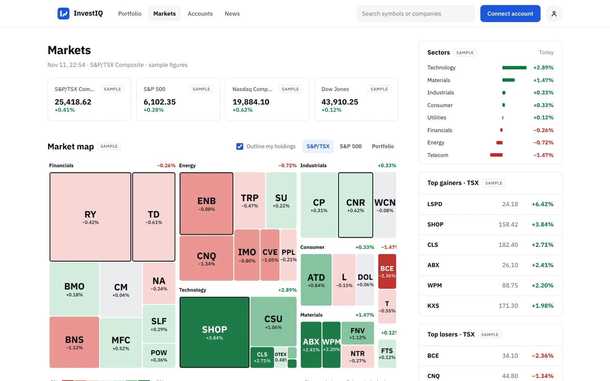</picture><br/><sub><b>Markets.</b> A sector map with your holdings outlined.</sub></td>
  </tr>
  <tr>
    <td width="50%"><picture><source media="(prefers-color-scheme: dark)" srcset="docs/readme/holding-dark.webp"/>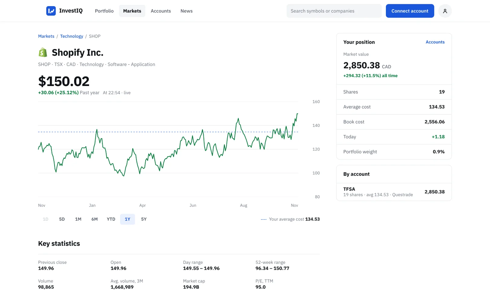</picture><br/><sub><b>Ticker.</b> Price history with your average cost line and position.</sub></td>
    <td width="50%"><picture><source media="(prefers-color-scheme: dark)" srcset="docs/readme/accounts-dark.webp"/>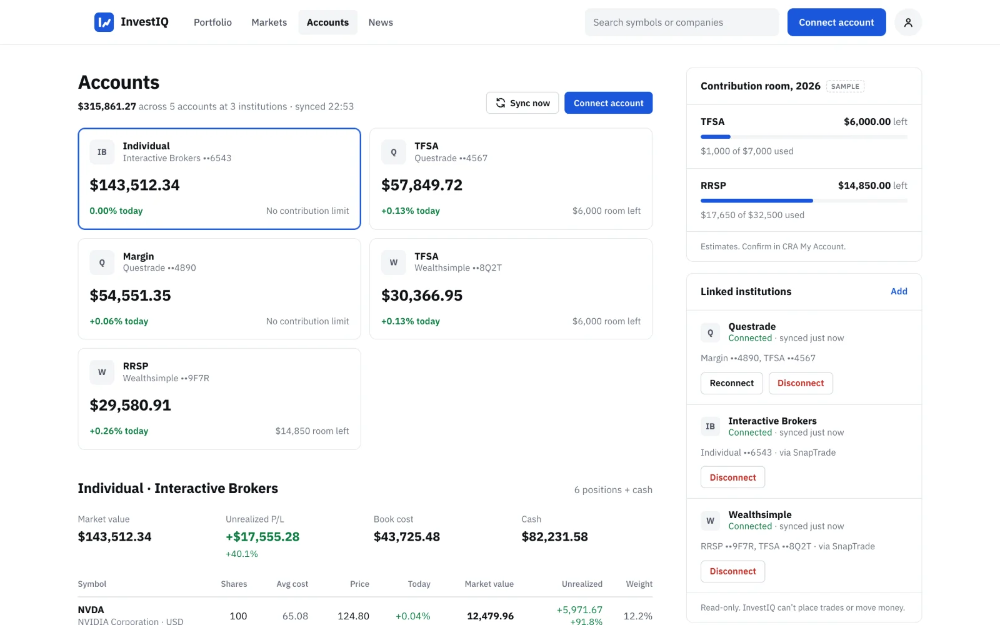</picture><br/><sub><b>Accounts.</b> Every account by institution, with sync status.</sub></td>
  </tr>
  <tr>
    <td width="50%"><picture><source media="(prefers-color-scheme: dark)" srcset="docs/readme/history-dark.webp"/>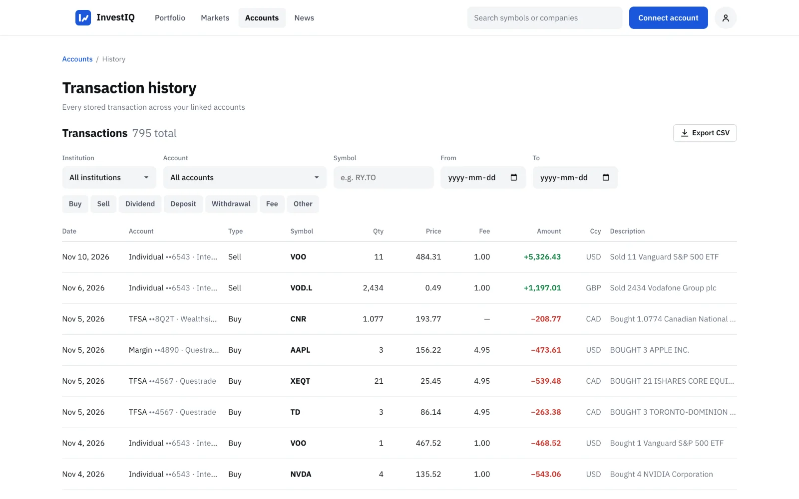</picture><br/><sub><b>History.</b> The stored ledger, filterable, with exact-decimal CSV.</sub></td>
    <td width="50%"><picture><source media="(prefers-color-scheme: dark)" srcset="docs/readme/news-dark.webp"/>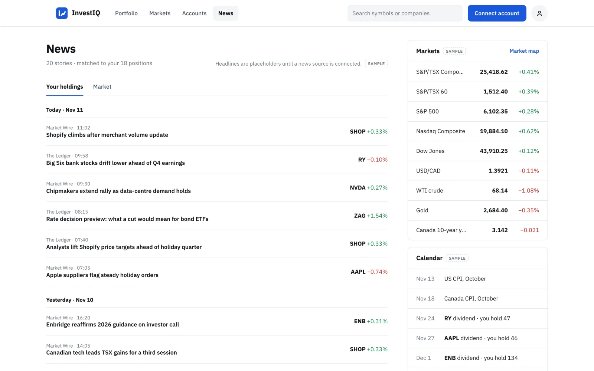</picture><br/><sub><b>News.</b> Headlines matched to your symbols.</sub></td>
  </tr>
</table>

<sub>Screens show the built-in demo: simulated brokers and a simulated market. Panels marked <i>Sample</i> in the app (index levels, sector moves, news, contribution room) use placeholder data until a source is connected.</sub>

## Run the demo

No broker accounts or API keys needed. The demo creates a fresh database, connects Questrade, Wealthsimple and Interactive Brokers through the app's real connect and sync code against in-process fakes of their APIs, then serves the real app while prices random-walk every second.

```sh
cd backend
python3 -m venv .venv && .venv/bin/pip install -r requirements.txt
.venv/bin/python -m demo                 # API on http://127.0.0.1:8000
```

```sh
cd portfolio-tracker
npm install && npm run dev               # http://localhost:5173
```

## Run against your accounts

Create `backend/.env` (never committed):

| Variable | |
|---|---|
| `TOKEN_ENCRYPTION_KEY` | Fernet key that encrypts broker tokens at rest |
| `QUESTRADE_CLIENT_ID`, `QUESTRADE_REDIRECT_URI` | Questrade OAuth app. An App Hub refresh token also works, via the Connect page |
| `SNAPTRADE_CLIENT_ID`, `SNAPTRADE_CONSUMER_KEY` | SnapTrade, for Wealthsimple and Interactive Brokers |
| `BASE_CURRENCY` | Currency for totals, default `CAD` |
| `SYNC_INTERVAL_MINUTES` | Background sync interval, default `60`, `0` turns it off |
| `DATABASE_URL` | Default `sqlite:///./investiq.db` |

```sh
cd backend
.venv/bin/alembic upgrade head
.venv/bin/uvicorn app.main:app
```

## Project layout

```
backend/                 FastAPI, SQLAlchemy 2, Alembic
  app/integrations/      Questrade (httpx) and SnapTrade adapters behind one interface
  app/services/          sync, ledger, performance, portfolio, FX, streaming, scheduler
  app/api/               REST, CSV export and the SSE stream
  app/proto/pnl.proto    the live P/L frame
  demo/                  simulated brokers and market, never imported by the app
portfolio-tracker/       React 19, TypeScript, Vite
```

## Tests

```sh
cd backend && .venv/bin/pytest -q        # 82 tests, all network mocked (respx, fakes)
cd portfolio-tracker && npm test         # 48 tests
```

One backend test runs the full demo seed and checks that its numbers reconcile to the fake brokers' own books.

## Status

A personal project, in progress. Authentication is a single-user placeholder, and the scheduler runs in-process. Questrade and SnapTrade field names follow their documentation and SDK types and have not yet been verified against live accounts. Market data comes from Yahoo Finance via `yfinance`, behind a `QuoteProvider` interface so it can be swapped.

<sub>Not investment advice.</sub>
